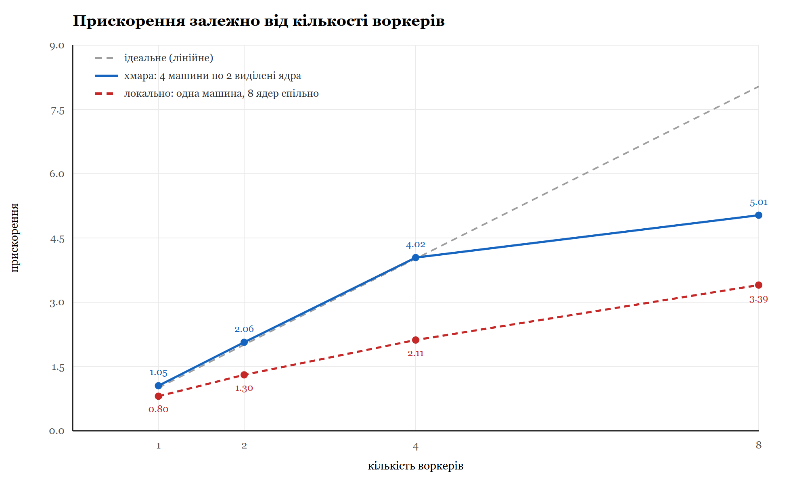

# Факторизація числа методом пробних дільників у системі ПАРКС

Лабораторна робота з курсу «Хмарні обчислення».
Тема з курсу РПП: **6.3 Факторизація числа методом пробних дільників**.
Платформа: **PARCS-Java**. Хмара: **Google Cloud Platform**.

## Задача

Для заданого числа `N` знайти всі його дільники в діапазоні `[2, √N]`
і побудувати повний розклад на прості множники.

Робочий приклад:

```
N = 4611685975477714963 = 2147483629 × 2147483647
√N = 2147483637  →  2 147 483 636 перевірок остачі
```

Обидва множники прості й близькі до кореня, тому перебір проходить майже весь
діапазон — час виконання не залежить від того, пощастить знайти дільник рано чи ні.

## Чому ця задача підходить для розподіленої системи

Воркеру надсилаються три числа (`N`, початок і кінець його відрізка), назад
повертається список знайдених дільників — зазвичай порожній або з одного елемента.
Обсяг мережевого обміну сталий, а обчислень — мільярди операцій остачі.
Відношення «обчислення / передача даних» дуже велике, тому накладні витрати
на мережу не з'їдають виграш від розпаралелювання.

Декомпозиція тривіальна: діапазон `[2, √N]` ріжеться на рівні за довжиною відрізки.
Кожен воркер виконує однакову кількість операцій, тому балансування навантаження
виходить само собою, без динамічного розподілу завдань.

## Структура

```
src/Factorize.java       кореневий модуль: читає вхідні дані, виконує послідовний
                         еталонний прохід, потім паралельні для кожної кількості
                         воркерів, перевіряє збіг результатів і друкує таблицю
src/TrialDivision.java   воркер: перебирає свій відрізок дільників
out/parcs.jar            бібліотека ПАРКС
out/input                вхідні дані
out/server               внутрішня IP-адреса hosts-server (створюється при розгортанні)
deploy/                  скрипти розгортання для кожного типу інстанса
Makefile                 збірка та запуск
```

### Формат `out/input`

```
number=4611685975477714963
workers=1 2 4 8
repeats=3
```

`number` — число для факторизації, `workers` — кількості воркерів, які треба перевірити,
`repeats` — скільки разів міряти кожну конфігурацію. Повтори потрібні, бо в хмарі
одиничне вимірювання ненадійне: впливають сусідні віртуальні машини та розігрів
JIT-компілятора. За основну характеристику береться найкращий час, середній наводиться поряд.

Крім таблиці у консоль, програма пише `out/results.csv` — із нього будується графік.

## Розгортання в Google Cloud

### 1. Створити інстанси

```
gcloud config set project ІДЕНТИФІКАТОР_ПРОЄКТУ
gcloud config set compute/zone europe-north1-a
gcloud config set compute/region europe-north1

gcloud compute instances create hosts-server daemon-1 daemon-2 app

gcloud compute firewall-rules create allow-all --direction=INGRESS --priority=1000 \
  --network=default --action=ALLOW --rules=all --source-ranges=0.0.0.0/0
```

Після створення треба виписати **внутрішні** IP-адреси всіх чотирьох машин
(Compute Engine → Екземпляри ВМ, стовпчик «Внутрішній IP-адрес»).

Кроки 2–4 нижче описані вручну. Те саме роблять готові скрипти з теки `deploy/`:

```
# на кожному daemon-*
bash daemon.sh

# на hosts-server, аргументи — внутрішні IP демонів
bash hosts-server.sh 10.166.0.4 10.166.0.5

# на app, аргументи — внутрішній IP hosts-server і посилання на репозиторій
bash app.sh 10.166.0.2 https://github.com/КОРИСТУВАЧ/РЕПОЗИТОРІЙ.git
```

Кожен скрипт наприкінці друкує внутрішню адресу своєї машини, тому виписувати
їх із консолі GCP не обов'язково.

### 2. Демони (на кожному `daemon-*`)

```
sudo apt-get update
sudo apt-get install -y openjdk-17-jdk-headless
wget https://github.com/lionell/labs/raw/master/parcs/Daemon/Daemon.jar
java -jar Daemon.jar &
```

Демон слухає порт **2222**.

### 3. Hosts-server

```
sudo apt-get update && sudo apt-get install -y openjdk-17-jdk-headless
wget https://github.com/lionell/labs/raw/master/parcs/HostsServer/TCPHostsServer.jar

touch hosts.list
echo ВНУТРІШНІЙ_IP_DAEMON_1 >> hosts.list
echo ВНУТРІШНІЙ_IP_DAEMON_2 >> hosts.list

java -jar TCPHostsServer.jar &
```

Сервер слухає порт **3333**.

### 4. Застосунок (на `app`)

```
sudo apt-get update && sudo apt-get install -y openjdk-17-jdk-headless git make
git clone ПОСИЛАННЯ_НА_ЦЕЙ_РЕПОЗИТОРІЙ
cd ЛР1_PARCS

echo ВНУТРІШНІЙ_IP_HOSTS_SERVER > out/server
make
```

### 5. Прибрати за собою

Інстанси тарифікуються, тому після вимірювань їх треба видалити:

```
gcloud compute instances delete daemon-1 daemon-2 hosts-server app
```

## Локальний запуск без хмари

Для перевірки все можна підняти на одній машині:

```
java -jar Daemon.jar &
echo 127.0.0.1 > hosts.list
java -jar TCPHostsServer.jar &
echo 127.0.0.1 > out/server
make
```

## Можливі проблеми зі збіркою та запуском

**`javac` не бачить класи ПАРКС.** Збірка потребує `parcs.jar` у classpath.
У `Makefile` це враховано; при ручній компіляції потрібен прапорець
`-cp out/parcs.jar`.

**Інструкція курсу вказує `openjdk-8-jdk`, але встановити його не вийде.**
У репозиторіях сучасного Debian (12 Bookworm, типовий образ GCP) цього пакета вже немає —
лишився `openjdk-17-jdk-headless`. Перевірено, що все працює на Java 17:
`parcs.jar` зібрано під Java 5 (версія класів 49), а JVM 17 виконує такий байт-код без змін.
Усередині бібліотеки немає жодного звертання до `sun.*` чи `com.sun.*`, лише
`java.io`, `java.net` і `java.util` — тому нічого з прибраного за ці роки вона не чіпає.

**Вкладені класи мають потрапити в jar.** Клас `Factorize.Settings` компілюється в
окремий файл `Factorize.class`. Якщо перелічувати файли для `jar` поіменно,
про нього легко забути, і застосунок падає з `NoClassDefFoundError` уже під час запуску.
У `Makefile` компіляція йде в окрему теку, а `jar` пакує її цілком.

**`javac` потребує `-encoding UTF-8`.** У коді є кирилиця, а типове кодування
компілятора залежить від локалі системи.

**Кирилиця у виводі.** Якщо консоль показує запитання замість літер, запускати з
`-Dfile.encoding=UTF-8`. На Linux-машинах GCP із локаллю UTF-8 це не потрібно.

**`Waiting for result...` без відповіді.** Означає, що hosts-server не достукався до
демонів. Перевірити: демони справді запущені (`java -jar Daemon.jar &` без помилок),
у `hosts.list` записані **внутрішні**, а не зовнішні адреси, і створено правило
брандмауера `allow-all`.

**Файл `out/server` не знайдено.** Програма шукає адресу hosts-server саме там;
без цього файла застосунок не стартує.

**`make` не встановлено.** На чистому інстансі його немає: `sudo apt-get install -y make`.

**Регіональна квота на vCPU не дає створити всі машини.** У щойно створеному проєкті
квота `CPUS` у регіоні зазвичай дорівнює **8**. Шість машин типу `e2-small` — це 12 vCPU,
тому `gcloud compute instances create` падає з `QUOTA_EXCEEDED` **посеред створення**:
частина інстансів уже піднялася, тарифікується й нічого не робить.

Із цього випливають два висновки, обидва враховані в `deploy/gcloud-all.sh`:

1. Квоту треба читати **до** створення, а не ловити помилку після. Скрипт запитує
   `gcloud compute regions describe --flatten=quotas[]`, рахує, скільки демонів
   поміщається, і за потреби сам зменшує їхню кількість, друкуючи попередження.
2. Не всім машинам потрібні ядра. `hosts-server` лише роздає адреси демонів і майже
   весь час простоює, тому для нього вистачає `e2-micro`. Решта машин рахують — і для
   них вибір типу виявився критичним, див. наступний пункт.

Повну картину на восьми воркерах дають чотири демони по два ядра. Якщо квоти бракує,
її збільшують тут — для метрики `CPUS` у потрібному регіоні, значення 12:
https://console.cloud.google.com/iam-admin/quotas?service=compute.googleapis.com
Для нового проєкту таке збільшення зазвичай схвалюється автоматично за кілька хвилин.

**Машини зі спільним ядром дають ефективність понад 100 %.** Найкаверзніша з усіх
проблем, бо програма при цьому працює правильно, нічого не падає, а числа виходять
беззмістовні.

Перший хмарний прогін дав таку таблицю:

```
воркерів      час, мс    прискорення    ефективність
1 (посл.)      121017           1,00           100 %
1               23936           5,06         505,59 %
2               12258           9,87         493,62 %
4               24766           4,89         122,16 %
8               19490           6,21          77,61 %
```

Ефективність понад 100 % неможлива: вона означає, що один воркер зробив роботу
вп'ятеро швидше за послідовний прохід, хоча виконує рівно той самий перебір.
Отже, неправильно зміряний **еталон**. І справді: локально послідовний прохід займав
5 394 мс, а тут — 121 017, у двадцять два рази більше.

Причина — тип машини. `e2-micro`, `e2-small` і `e2-medium` належать до машин зі
**спільним ядром** (shared-core, burstable): гарантовано вони дають лише 0,25, 0,5
та 1 ядра відповідно, а понад цю частку працюють на накопичених кредитах. Кредити
за хвилину суцільного рахунку вичерпуються, і машину притискають до базової частки.
Послідовний еталон виконується на `app`, і саме там це й сталося. Стрибки серед
паралельних рядків (2 воркери — 12 258 мс, а 4 — раптом 24 766) мають ту саму природу.

Для будь-яких вимірювань часу потрібні машини з **виділеними** ядрами, тому `app`
і демони створюються як `e2-standard-2`. Правило загальне: **на burstable-інстансах
не можна міряти продуктивність** — вони для навантаження, що чергується з простоєм.

**Закрита вкладка Cloud Shell обриває розгортання.** Сесія Cloud Shell живе рівно доти,
доки відкрита вкладка браузера: варто піти зі сторінки — і скрипт помирає посеред роботи.
Інстанси при цьому **лишаються створеними й тарифікуються**, а запущені на них демони
нікуди не діваються, бо стартують через `nohup` і від сесії не залежать.

Тому `gcloud-all.sh` зроблено **повторюваним**: він створює лише ті машини, яких ще немає,
і перед запуском демона чи hosts-server глушить попередній процес, щоб другий екземпляр
не впав з `Address already in use`. Після обриву достатньо запустити той самий скрипт
ще раз — він підхопить уже створене й доведе справу до кінця.

Що саме лишилося живим, показує:

```
gcloud compute instances list
```

**`pkill -f` убиває власну оболонку, і ssh падає з кодом 255.** Пастка, на яку легко
натрапити саме в такому скрипті. `gcloud compute ssh --command` виконує весь блок як
**один** командний рядок, а `pkill -f` шукає свій шаблон у командних рядках усіх процесів —
включно з тим, усередині якого сам і запущений. Блок для демона містить і
`wget -q -O Daemon.jar`, і зупинку попереднього процесу, тому `pkill -f Daemon.jar`
знаходив слово `Daemon.jar` в аргументі `wget`, убивав оболонку ssh, і з'єднання рвалося.

Ззовні це виглядає як проблема з мережею: `ERROR: (gcloud.compute.ssh) exited with
return code [255]`, та сама порада про `--troubleshoot`. Але машина при цьому доступна —
проста перевірка `gcloud compute ssh daemon-1 --command "echo OK"` проходить. Саме ця
розбіжність і вказує, що справа не в доступі, а в самій команді.

Трюк із дужками (`pkill -f '[D]aemon.jar'`) рятує лише від збігу шаблона **сам із собою**
і тут не допомагає, бо слово трапляється в рядку ще й окремо. Тому процеси зупиняються
за **pid-файлом**:

```
{ [ -f daemon.pid ] && kill $(cat daemon.pid) 2>/dev/null; true; } &&
(nohup java -jar Daemon.jar > daemon.log 2>&1 & echo $! > daemon.pid)
```

Так зупиняється рівно той процес, який запустив попередній прогін, і жоден інший.

## Результати

Конфігурація замірів: Google Cloud, зона `europe-north1-a`, чотири демони `e2-standard-2`
по два **виділені** ядра — разом 8 ядер під воркери. Кожен замір повторено тричі, за
основу береться найкращий час. Програма окремо перевіряє, що паралельний результат
збігається з послідовним (стовпчик «збіг»).

| воркерів | час, мс | сер., мс | прискорення | ефективність | збіг |
|---|---|---|---|---|---|
| 1 (посл.) | 24 206 | 24 322 | 1,00 | 100 % | еталон |
| 1 | 23 126 | 23 837 | 1,05 | 104,67 % | так |
| 2 | 11 774 | 12 048 | 2,06 | 102,79 % | так |
| 4 | 6 014 | 6 262 | 4,02 | 100,62 % | так |
| 8 | 4 833 | 5 740 | 5,01 | 62,61 % | так |



**Накладні витрати ПАРКС практично нульові.** Один воркер відпрацьовує за час
послідовного проходу (1,05). Це підтверджує міркування з розділу «Чому ця задача
підходить для розподіленої системи»: воркеру передаються три числа, назад повертається
короткий список, а рахує він понад півмільярда операцій остачі. Надлишок у 5 % лежить
у межах різниці між машинами — еталон міряється на `app`, а воркер працює на окремому
демоні, де більше нічого не виконується.

**До чотирьох воркерів прискорення майже лінійне** — 2,06 і 4,02 за ефективності
близько 100 %. Діапазон `[2, √N]` ріжеться на рівні за довжиною відрізки, кожен воркер
виконує однакову кількість операцій, тому балансування навантаження не потрібне.

**На восьми воркерах ефективність падає до 62,6 %**, і цьому є дві причини. По-перше,
вісім воркерів рівно насичують усі вісім виділених ядер: на кожній машині два воркери
ділять між собою кеш і пропускну здатність пам'яті, а поряд працює ще й JVM самого
демона. По-друге, кожен воркер — окремий процес JVM, і його запуск коштує приблизно
однаково незалежно від довжини відрізка, тоді як сам відрізок удвічі коротший, ніж на
чотирьох воркерах. Оцінити ці сталі витрати можна так: чотири воркери дали 6 014 мс,
вісім мали б ідеально дати 3 007 мс, а дали 4 833 — тобто близько 1,8 секунди
припадає на витрати, що не залежать від обсягу роботи.

### Порівняння з локальним прогоном

Той самий код на одній машині з 8 ядрами (`results/local_run.txt`) дає помітно гіршу
картину: один воркер **повільніший** за послідовний прохід (0,80), а вісім дають лише
3,39 за ефективності 42 %. Причина в тому, що там усі воркери ділили ті самі вісім
ядер разом із JVM кореневого модуля. У хмарі кореневий модуль, hosts-server і воркери
рознесені по різних машинах, і саме тому крива лягає майже на ідеальну аж до чотирьох
воркерів. Це і є практичний сенс розподіленої системи — обидві криві наведено на
графіку вище.

Зібрані вимірювання — у теці `results/`: `cloud_results.csv` і `cloud_run.txt` для
хмарного прогону, `local_run.txt` для локального, `speedup.png` — графік.
